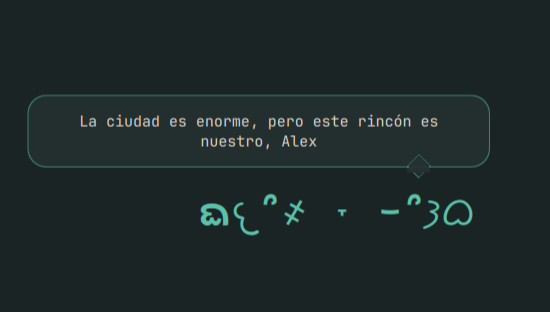

# Niku Companion

**ᨳ𐔌՞҂ ˕ ֊՞𐦯ᜊ** A quiet kaomoji friend for your Omarchy desktop.

Personalized Spanish messages about creativity, repairing machines, distant
signals and life inside a megastructure. A gentle floating animation and
the soft green Lifeless palette, with no network requests or AI service.



*Actual widget rendering with the fictional name Alex on a plain background.*

## Install

Requires Omarchy Quattro with its Quickshell-based shell and Hyprland.
Developed on Omarchy 4.0.6. The configured desktop font must support the
kaomoji's Unicode characters. No additional runtime packages are needed.

```bash
omarchy plugin add https://github.com/javihuh/niku-companion-omarchy --enable
```

On first activation Niku asks **“¿Cómo quieres que te llame?”**. Enter your
name or choose **“Continuar sin nombre”**. The widget lives in the bottom-right
corner of workspace 1 on the first monitor returned by Quickshell by default.
It is click-through and sits behind application windows.

## Messages and rotation

- **101 Spanish phrases**: 22 per time-of-day group and 13 hydration messages.
- Changes every **10 minutes of active-workspace time**.
- Hydration reminder every **30 minutes of active-workspace time**, displayed
  for the usual message interval. It replaces one normal message slot.
- Each group draws without repeats until exhausted. A new cycle avoids
  immediately repeating the last phrase (unless the group has only one).
- Groups: morning 05:00–12:00, afternoon 12:00–19:00, evening 19:00–23:00,
  night 23:00–05:00, using the local clock.
- Switching workspaces or disabling the plugin pauses the timers. Reopening
  a time-of-day group resumes its last phrase. Suspend time is not counted.
- Rotation is saved on message changes, when hiding, and every 30 seconds.
  An abrupt process kill may lose up to 30 seconds of timer progress.

“Visible” means the target workspace is active on the selected monitor. Niku
does not inspect other applications: covering it with a window does not pause
the timer. All 101 messages are discovered over multiple days, not necessarily
within a single day.

## Personalize

Reopen the name dialog:

```bash
omarchy-shell io.github.javihuh.companion configure
```

Preferences live outside the plugin repository, in
`~/.config/niku-companion/config.json`. Edit the existing file, preserving any
other settings you want to keep. Changes reload automatically:

```json
{
  "name": "Alex",
  "setupComplete": true,
  "creature": "ฅ(•ㅅ•)ฅ",
  "workspace": 1,
  "monitor": "",
  "marginRight": 48,
  "marginBottom": 42,
  "changeMinutes": 10,
  "hydrationEveryMinutes": 30
}
```

### Change the creature

Set `creature` to any kaomoji or text, for example `ฅ(•ㅅ•)ฅ`, `(◕‿◕)` or
`[◉_◉]`. Images/GIFs are not supported. The font determines which characters
can be rendered. The default creature and all other bundled values are in
[`personality.json`](personality.json).

### Placement and timing

`monitor` can be a Hyprland output name such as `eDP-1`; an empty string uses
the first Quickshell screen. With an explicit monitor, Niku hides and pauses
when that monitor is absent. Use `hyprctl monitors` to find output names.
`workspace` is a positive numeric workspace ID. Margins are pixels from the
bottom/right edges. Timer values are positive minutes; the hydration interval
is at least the message interval.

### Custom phrases

Use `{name}` as a placeholder. Names are inserted as plain text. If no name
is set, the placeholder and its adjacent comma are removed.

Add an override to the existing config file, for example:

```json
"periods": {
  "night": {
    "messages": [
      "La ciudad es enorme, pero este rincón es nuestro, {name}",
      "{name}, recibí una señal. Creo que decía hola"
    ]
  }
},
"hydrationMessages": ["{name}, recuerda tomar agüita"]
```

An overridden group replaces that group's bundled list; other groups retain
their defaults. Use nonempty arrays of strings. The rotation keeps track of
the message text, so adding phrases preserves progress for unchanged phrases.
To extend a group, copy its bundled list into the override and append yours.

## Updates and removal

```bash
omarchy plugin update io.github.javihuh.companion
omarchy plugin disable io.github.javihuh.companion
omarchy plugin enable io.github.javihuh.companion
omarchy plugin remove io.github.javihuh.companion
```

Your name, preferences and rotation survive updates and removal:

| File | Contents |
| --- | --- |
| `~/.config/niku-companion/config.json` | Name, onboarding completion, overrides |
| `~/.local/state/niku-companion/rotation.json` | Seen phrases, current message, timers |

`XDG_CONFIG_HOME` and `XDG_STATE_HOME` are respected when set. For a complete
reset, disable/remove the plugin first, then remove those two directories.
To reset only the rotation, disable it, remove `rotation.json`, then enable it.
Do not edit files inside the installed Git checkout; use `config.json` so
updates can fast-forward cleanly.

## Diagnostics and development

```bash
omarchy-shell io.github.javihuh.companion status
omarchy plugin validate .
/usr/lib/qt6/bin/qmllint -I /usr/share/omarchy/shell Service.qml DesktopCompanion.qml Welcome.qml
node --test tests/*.test.cjs
```

The Node tests use only the standard library; Node is needed for development,
not for running the plugin. The service creates its own config/state directories
with `mkdir` and uses Quickshell's atomic file writes. It never uploads the name,
invokes a shell with user input, or modifies Hyprland configuration.

Malformed/unreadable JSON is reported in the shell logs and `status` instead
of silently overwriting your file. Correct the file and reload the plugin.

## License

[MIT](LICENSE). An independent community plugin for Omarchy.
